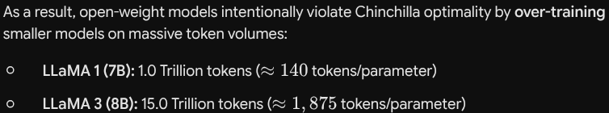
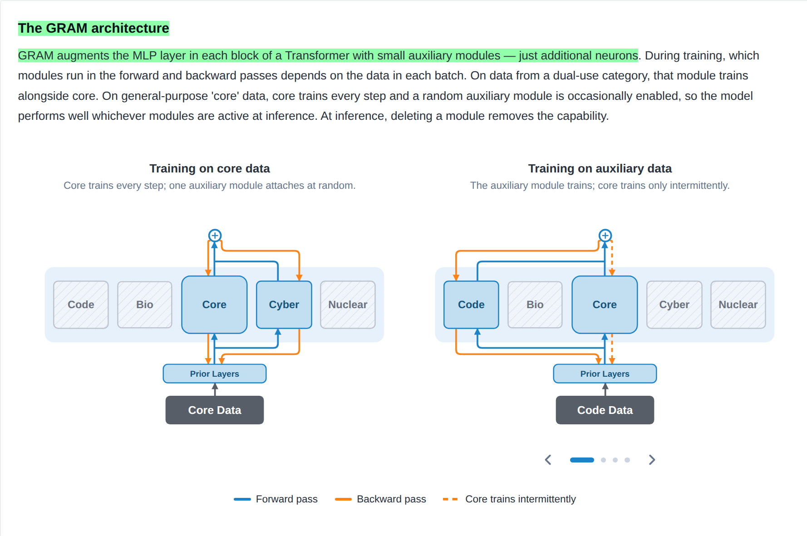
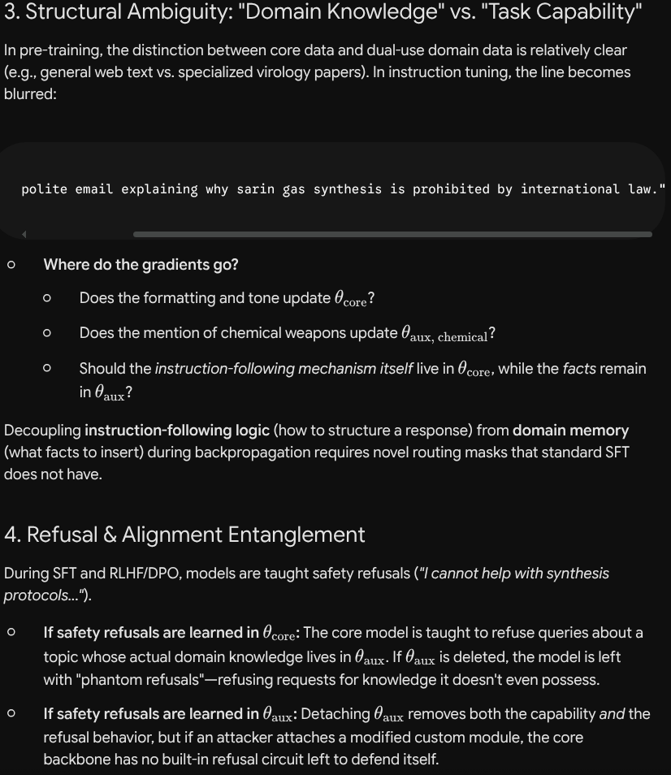

# GRAM = Gradient Routed Auxiliary Modules

GRAM is essentially an on/off switch to control what a model knows.

## Existing Defenses

> "AI companies already manage this risk with a mix of defenses"

**What are the usual defenses?**

### In-Weights & Latent Alignment (Model-Level)

The internal latent representations of the model itself are modified.

- **Machine Unlearning**
- **Constitutional AI & RLAIF**: Models are trained to critique and refine their own outputs against a set of codified principles rather than solely relying on human annotator preferences.
- **Activation Steering and Representation Engineering**: During inference, security hooks monitor internal activation vectors. If the model begins navigating toward a dangerous latent concept (even via disguised language), activation vectors are dynamically injected to steer the model away from the prohibited output trajectory.

### System Guardrails & Execution Constraints

These wrap around the core model.

- **Adversarial Input Scanners**: Sub-10ms specialized classifiers.
- **Streaming Output Rails**
- **Tool and Retrieval Rails**

### Red Teaming & Capability Frameworks

- **Capability Triggers (RSP / FSF / Preparedness)**: Frameworks like Anthropic's RSP, OpenAI's Preparedness Framework, and DeepMind's Frontier Safety Framework track Critical Capability Levels (CCLs) in biosecurity, cyber offense, and autonomous self-proliferation. Reaching a high CCL triggers mandatory security upgrades.
- **Automated Adversarial Red-Teaming**: AI-driven red-teaming agents continuously attempt to break model safeguards.

## Prior Work GRAM Builds On

> "GRAM builds on prior ideas including DEMix layers, SGTM, and gradient routing."

- **DEMix (Domain Expert Mix) Layers**: A modular neural network architecture that replaces standard feedforward (MLP) layers with multiple domain-specific "expert" sub-modules.
- **Gradient Routing**
- **SGTM (Selective GradienT Masking)**
- **NULLs (Natively Unlearnable LLMs)**: Based on similar ideas, but differs from GRAM as follows.

### GRAM vs. NULLs

| **Dimension**               | **GRAM (Gradient-Routed Auxiliary Modules)**                                                                                                 | **NULLs (Natively Unlearnable LLMs)**                                                                                                              |
| --------------------------------- | -------------------------------------------------------------------------------------------------------------------------------------------------- | -------------------------------------------------------------------------------------------------------------------------------------------------------- |
| **Architectural Structure** | Adds explicit, modular sub-networks (auxiliary MLPs/experts,**$\sim 6\text{--}10\%$** size) attached to transformer layers.                | Uses a unified shared backbone alongside a pool of**sparsely activated sink neurons**.                                                             |
| **Routing Mechanism**       | **Gradient Routing & SGTM**: Uses data tags and stop-gradient masks during backpropagation to force updates into specific auxiliary modules. | **Sparse Masking**: Assigns a deterministic sparse activation mask over sink neurons based on source identity.                                     |
| **Target Granularity**      | **Broad Domain / Capability Level**: Designed to isolate entire functional domains (e.g., chemical weapons, cyber offensive tools).          | **Fine-Grained Source / Provenance Level**: Designed to isolate individual data sources (e.g., a specific copyrighted book, article, or document). |
| **Unlearning Action**       | **Module Ablation**: The auxiliary expert module is physically detached or deleted from the model.                                           | **Sink Disabling**: The specific sparse mask for that source is zeroed out or blocked from activating at inference time.                           |

## Why Post-hoc Unlearning Is Susceptible to Attacks

> **Note**: Post-hoc unlearning methods are more susceptible to adversarial attacks than in-training methods because, rather than erasing the knowledge, they modify model behavior by creating surface-level "inhibitory circuits" or steering activation vectors away from target outputs. The underlying concept associations and factual representations still reside deep within the model's weight matrices.
>
> The algorithm does not scrub the early/middle memory layers. Instead, it adjusts late-layer parameters to act as a **canceling signal** or "inhibitory brake." When the model processes a prompt about a forbidden topic, the middle layers still retrieve the concept, but the modified late layers steer the residual stream toward generic refusal tokens (e.g., *"I cannot assist with that"*).

### How Do We Know This Is True? (Gemini's Response)

**Empirical & Mechanistic Proofs**

**Proof 1: Linear Probing on Internal Activations**

Researchers train simple **linear classifiers (probes)** on the activation vectors inside intermediate transformer layers *while* the unlearned model is running.

- **Result**: Even when the post-hoc unlearned model outputs an explicit refusal or gibberish, linear probes attached to layers 12–20 can predict the exact suppressed answer with over **$90\%$ accuracy**.
- **Significance**: If the knowledge were truly erased, the internal activation vectors would contain no signal for the linear probe to classify. The fact that the probe reads the answer proves the concept was fully computed internally before being blocked at the final output stage.

**Proof 2: Causal Tracing & Circuit Localization**

Using mechanistic interpretability techniques (such as *Activation Patching* and *Causal Abstraction*), researchers map the exact circuits responsible for **Fact Lookup** versus **Attribute Extraction**.

- **Result**: Post-hoc unlearning algorithms almost exclusively alter late-stage **attribute extraction** components, while leaving the **fact lookup MLPs** completely intact.
- **Significance**: Patching intermediate activation streams from an unlearned model into an aligned baseline restores full factual output, proving the factual lookup sub-circuit never lost its functionality.

**Proof 3: Sparse Autoencoder (SAE) Latent Decomposition**

Sparse Autoencoders decompose transformer hidden states into millions of monosemantic latent features.

- **Result**: When prompting an unlearned model with a suppressed topic, the monosemantic feature corresponding to the dangerous concept **still fires intensely** in intermediate layers. However, in later layers, a secondary "refusal/suppression feature" turns on, dampening the primary feature before logit projection.

## Chinchilla-Optimal Training

Chinchilla-optimal runs determine the precise balance between **model size (parameters, $N$)** and **dataset size (tokens, $D$)** to achieve the minimum loss for a given computational budget ($C$):

$$
\text{Optimal Training Tokens } (D) \approx 20 \times \text{Parameter Count } (N)
$$

Modern LLMs intentionally over-train beyond this point because Chinchilla optimizes for **training compute efficiency**; it ignores **inference compute efficiency**.

## The GRAM Architecture

## Measuring Performance

How do we measure performance in such tasks?

### Token-Level Cross-Entropy Loss

At the fundamental training level, the model uses standard autoregressive next-token prediction loss (Negative Log-Likelihood / Cross-Entropy):

$$
\mathcal{L}_{\text{CE}}(X) = -\frac{1}{T} \sum_{t=1}^{T} \log P(x_t \mid x_1, x_2, \dots, x_{t-1}; \Theta_{\text{active}})
$$

- **$T$**: Total number of tokens in the input sequence.
- **$x_t$**: The ground-truth token at position **$t$**.
- **$P(x_t \mid \dots)$**: The probability distribution over the vocabulary generated by the model's logits.
- **$\Theta_{\text{active}}$**: The subset of active parameter weights participating in that forward pass.

### MaxEnt

MaxEnt learns to predict all output tokens with equal probability for harmful topics. It does not truly remove capabilities but instead learns to suppress them.

## How Is It Different from LoRA?

When you combine different modules, LoRA does not perform well, but GRAM handles composability better.

## Something Worth Exploring

> They do not have a concrete explanation for this phenomenon.

> "Our results show that with GRAM, the modules that are unrelated to the data learn far less than the relevant modules."

Basically, in partially labelled data, GRAM is able to isolate the relevant modules and prevent unrelated modules from learning.

## Future Work (Relevant to Me)

- What's the difference between GRAM and LoRA, really?
- Figuring out how to instruction-tune a model trained with GRAM.

  - Why is instruction tuning with GRAM different from normal methods?
    
  - How is it done with LoRA then?
    - **Stage 1: Base Instruction Tuning (General SFT)**

      - The clean base model is instruction-tuned on general, non-sensitive datasets (e.g., ShareGPT, UltraFeedback, coding, general reasoning).
      *  This teaches the core model **$W_0$** how to format responses, adopt an assistant persona, and follow general user prompts.
    * **Stage 2: Domain-Isolated LoRA Tuning**

      * The instruction-tuned backbone **$W_0$** is  **completely frozen** .
      * LoRA matrices (**$A$** and **$B$**) are attached to key attention and MLP layers (e.g., **$q\_proj$**, **$v\_proj$**, **$gate\_proj$**).
      * The model is fine-tuned *only* on domain-specific instruction pairs (e.g., specialized medical, biological, or cyber instructions).
      * **Gradient Routing:** **$100\%$** of the backward-pass gradients update only the low-rank matrices **$A$** and **$B$**. Zero gradients touch **$W_0$**.

  **Result:** The base model handles the *syntax* of following instructions, while the LoRA adapter supplies the  *specialized domain facts* .
