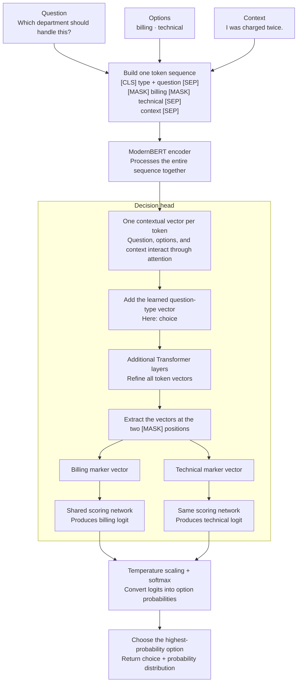

###  General notes
- The English Laya checkpoint uses a bidirectional ModernBERT encoder with decision heads; the multilingual checkpoint uses mmBERT.
- State is not encoded once and freely reused rather everytime it is computed again.So do not send questions that are dependent on each other's outputs in one call rather make subsequent calls.
- There are 3 types of questions atm: Choice, Score, and Noul
- Needs very specific context and any added information negatively impacts the results(way more than usal Language models)
- Different available checkpoints for this atm.
| Checkpoint | Encoder and size | Default context | Best starting point |
|---|---|---|---|
| laya | ModernBERT-large, about 421M parameters | 512 tokens | English decision workloads. |
| laya-multilingual | mmBERT-base, about 322M parameters | 1,024 tokens | Non-English or mixed-language traffic. |
| laya-typed-decisions | ModernBERT-large, about 421M parameters | 1,024 tokens | Workflows resembling its typed-decisions training tasks. |

### Flow of information in Laya:

