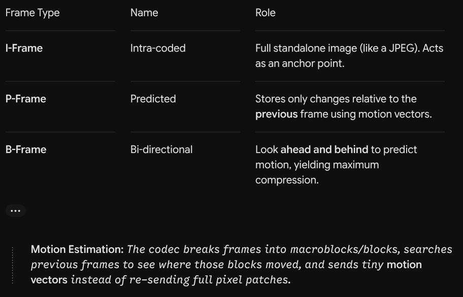
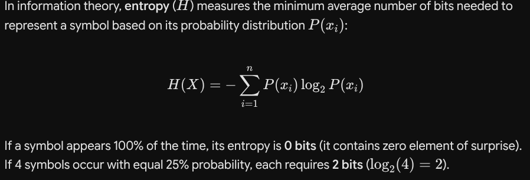
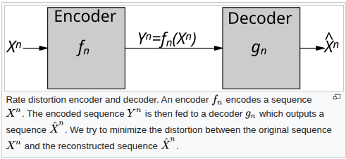
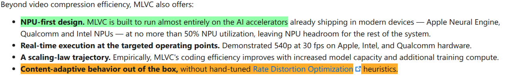
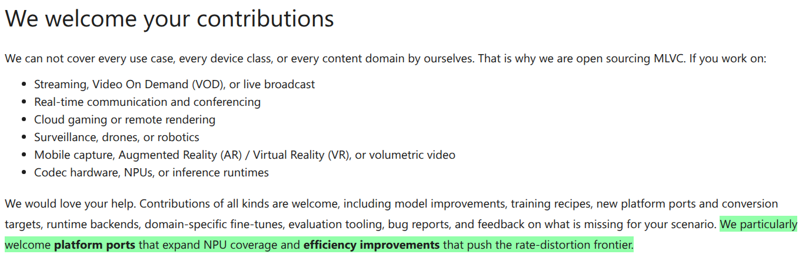

Why am i reading about them?
----------------------------

Saw this post by microsoft and wanted to understant this:
[MLVC blog by Microsoft](https://techcommunity.microsoft.com/blog/linuxandopensourceblog/announcing-the-open-source-release-of-ml-video-codec-mlvc/4539875)
Original repo: [MLVC GitHub](https://github.com/microsoft/mlvc)

### What is a video codec?

codec = coder-decoder
It compresses raw video data into a tiny fraction of its original size for streaming or storage, then decompresses it for playback.

Mostly this is achieved by eliminating the following 3:

- Perceptual Redundancy: Removing color information human eyes can't easily detect.
- Temporal Redundancy: Eliminating repeated information between consecutive frames.
- Spatial Redundancy: Grouping similar pixel areas within a single frame.

### Step-by-Step Encoding Pipeline(This is mostly from Gemini):

1. Chroma Subsampling (Color Reduction)
   Raw video splits into Luminance (Y) for brightness and Chrominance (Cb, Cr) for color. Because human eyes are far more sensitive to fine brightness detail than color changes, codecs toss out up to 75% of the color data (typically using 4:2:0 subsampling) before doing complex calculations.
2. Frame Types & Temporal Prediction
   Instead of storing every frame completely, codecs categorize video frames into three types (a GOP or Group of Pictures):
   
3. Spatial Prediction & Residual Calculation
   For blocks that can't be predicted from other frames, the encoder performs intra-prediction: predicting a block's content from adjacent pixels already decoded in the same frame.The encoder then calculates the Residual—the mathematical difference between the actual frame and the predicted frame. Only this residual is sent down the pipeline.
4. Transform (Frequency Domain)
   The residual block is passed through a transform function, most commonly the Discrete Cosine Transform (DCT) or Discrete Sine Transform (DST). This translates spatial pixel values into frequency components, separating smooth, large-scale changes (low frequencies) from sharp, fine details (high frequencies).
5. Quantization (This is lossy)
   Quantization divides the frequency values by a scaling factor and rounds them to integers:High-frequency values (fine detail/noise) drop to zero.This is where lossy compression occurs. Higher quantization saves bandwidth at the expense of visual quality.
6. Entropy Coding (Lossless Compression)
   Finally, the stream of vectors, block modes, and quantized coefficients undergoes lossless entropy encoding (like CABAC or Huffman coding). Repeated zeros and common patterns are represented by shorter binary codes, creating the final bitstream (.h264, .hevc, .av1).
   Lossless entropy encoding: assigns shorter codes to frequently occurring symbols and longer codes to rare ones. This is based on the concept of Shannon Entropy
   

## MLVC

"MLVC replaces conventional primitives — motion estimation, transforms, entropy modeling — with end-to-end learned neural compression, trained directly against rate-distortion objectives, and run on general-purpose NPU devices."
Rate distortion objectives: It is a branch of information theory which studies the trade-off between the compression rate and the distortion (loss of quality) introduced by compression.
This image is from Wikipedia:

They showed results on:

- [P.910 subjective test](https://www.itu.int/rec/t-rec-p.910/en): This specifies standard methods for subjective video quality assessment in multimedia applications.
- [VCD dataset](https://github.com/microsoft/VCD): "It is designed to evaluate video codecs for video conferencing. The VCD encompasses a broad range of camera qualities, along with spatial and temporal information. This dataset comprises 160 video clips, organized into four scenarios. Each sequence is presented in 1080p resolution, at 30 FPS, with a duration of 10 seconds, and features a person visible throughout the entire video."
  ***Question:*** What is the performance on other tasks and datasets? --I have not read paper yet

***Oppurtunity:***
"Currently, both encoding and decoding require the same model version, so some form of versioning is needed to maintain stream compatibility within an application. We welcome efforts to standardize this aspect so that interoperability can be achieved across the board."

